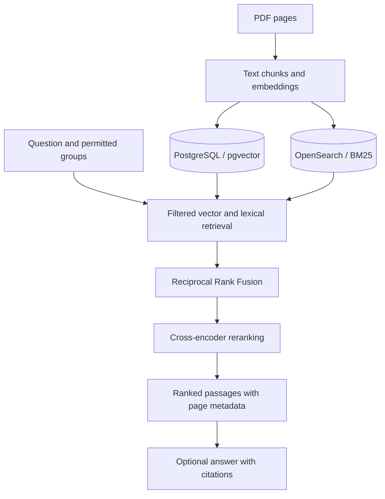

# JKUAI — Permission-Aware University Search

[](https://github.com/Aryamanjmwl/JKUAI/actions/workflows/ci.yml)
[](LICENSE)

JKUAI searches university PDFs using BM25, vector embeddings, and cross-encoder
reranking. It can generate answers from retrieved passages with inline citations,
physical PDF page numbers, filenames, and source links when supplied.

Permission filters run before passages reach the reranker or answer generator.
PostgreSQL is the authority for access decisions, including when OpenSearch contains
an outdated grant. This is an independent portfolio prototype, not an official JKU service.

## Try it locally

The complete demo runs in Docker: PostgreSQL/pgvector, OpenSearch, FastAPI, and the React
client. You do not need host Python, Node.js, downloaded PDFs, or an OpenAI key for
source search.

**Requirements:** Git, Docker with Compose v2.20+, and a running Docker engine. On
Windows use Docker Desktop with Linux containers. Allow about 6 GB RAM and 10 GB free
disk space. The first build downloads Python packages and CPU inference dependencies;
the first seed downloads two ML models. Subsequent runs reuse image layers and a model
cache. The automated verification uses Linux x86-64 containers.

On Linux, OpenSearch requires `vm.max_map_count` of at least 262144. Check
`cat /proc/sys/vm/max_map_count`; if lower, run `sudo sysctl -w vm.max_map_count=262144`
before starting the services. Docker Desktop manages the Linux VM separately.

Clone the repository, then run these commands **from its root directory**. They work in
PowerShell and POSIX shells:

```sh
git clone https://github.com/Aryamanjmwl/JKUAI.git
cd JKUAI
docker compose -f docker-compose.yml -f docker-compose.demo.yml up -d --build --wait --wait-timeout 180
docker compose -f docker-compose.yml -f docker-compose.demo.yml run --rm seed
```

The seed command must finish with `"status": "passed"`. It uploads three **clearly
labelled fictional university PDFs**, checks their ranking and role isolation, and
writes the PDFs and check report to `data/demo-output/`. These examples demonstrate the
pipeline; they are not actual university regulations. Repeating the seed is safe and
checks deduplication.

Open **<http://localhost:5173>**. Use **Ask JKUAI** and try:

| Role | Question | Expected result |
|---|---|---|
| Public visitor | What do I need before taking Advanced Machine Learning? | Course Guide ranks first; its excerpt names Introduction to Machine Learning and Linear Algebra. |
| Public visitor | What happens if I miss an exam because of illness? | Exam Regulations ranks first; the excerpt explains notification and a medical certificate. |
| Public visitor | What is the EXAM-OPS-42 internal routing code? | No Staff Operations passage or ORCHID-742 appears. Unrelated public passages can still appear. |
| Staff member | What is the EXAM-OPS-42 internal routing code? | Staff Operations ranks first and includes ORCHID-742. |

The Docker demo explicitly enables **simulated roles** in both services. They are not
login identities. Services bind to localhost; keep this configuration local.

### Add your own documents

Click **Add PDF** in the top-right corner, choose a text PDF, review its title, and click
**Upload PDF**. You can supply the original source URL so results link back to it.
The success message shows how many passages were indexed; the document is immediately
searchable. Uploading the same PDF again reuses its existing record.

In the local role demo, **Selected groups** lets you restrict retrieval to comma-separated
groups such as `students` or `staff`. Choose a matching simulated role to search a
restricted document. A duplicate with incompatible permissions returns a conflict;
reuploading is not an ACL-edit operation.

### Generate an answer with Gemini or OpenAI

The page defaults to **Google Gemini**, using `gemini-3.1-flash-lite`.
Google currently lists a limited free tier for this model. Eligibility and quotas depend
on your Google AI Studio project; the app cannot grant credits or change billing plans.

1. Create a key in [Google AI Studio](https://aistudio.google.com/apikey) for a project
   on the free tier. Paid projects can incur usage charges; check your project tier.
2. Select **Google Gemini** under **Answer provider**, paste the key into the local app,
   and choose **Use this key**. Do not put the key in Git, screenshots, or chat messages.
3. Ask a question supported by your PDF. The answer includes clickable `[S1]` source tags.

Choose **Change API key** to replace the key or select **OpenAI** instead. Switching
providers clears the key and results while preserving your question. An OpenAI key
cannot be used with Gemini or vice versa. Keys stay in tab memory and are cleared on
refresh or Disconnect. The application does not persist them in browser storage or its
stores. Only the selected provider receives the question and accessible passages.
Review Google's data terms before using confidential documents, especially on a free tier.

OpenAI uses the Responses API with `gpt-4.1-mini`; Gemini uses Google's documented
OpenAI-compatible Chat Completions endpoint. Configure `OPENAI_MODEL` or `GEMINI_MODEL`
in an optional root `.env`, then recreate the API to change models. Defaults are checked
against provider documentation, but model availability and free quotas may change.
The compatibility client is shared; retrieval and permission filtering remain local.

If Gemini reports a free-tier limit, check your limits in AI Studio and wait for quota
to reset. A new key in the same project does not reset quota. No automatic provider
fallback is performed; failures keep retrieved passages visible. Missing or invented
citation IDs and incomplete Gemini output produce an insufficient-evidence response;
valid IDs alone do not prove factual support.

References: [Google compatibility API](https://ai.google.dev/gemini-api/docs/openai),
[model](https://ai.google.dev/gemini-api/docs/models/gemini-3.1-flash-lite),
[pricing and free tier](https://ai.google.dev/gemini-api/docs/pricing),
[data terms](https://ai.google.dev/gemini-api/terms).

## Try a real university PDF

The fictional prerequisites above are not claimed to exist in this official curriculum.
For a real-document example, download the JKU Computer Science Master's curriculum
using [the native setup guide](docs/local-development.md#add-an-official-document),
then use the app’s upload form:

1. Download <https://studienhandbuch.jku.at/texte/1170_7_MS_ComputerScience.pdf>.
2. Click **Add PDF** at the top of the app. Select the PDF, enter a title and its source
   URL, and leave access set to **Everyone (public)**. Click **Upload PDF** and wait for
   **Document added**. Text PDFs up to 10 MiB are supported; scanned/encrypted PDFs are not.
3. Ask: **How many ECTS points is the written Master's thesis in Computer Science worth?**

The document smoke test checks a supporting passage on physical PDF page 7, along with
its filename, source URL, and citation ID. This is checked against the downloaded
curriculum version; inspect the PDF if the university replaces it. The original PDF
bytes are not retained by the API: keep your copy or provide a source URL.

## How it works



Each retriever supplies up to 20 candidates. RRF merges by chunk ID using
`1 / (60 + rank)` contributions. The best 20 fused candidates are reranked to at most
five passages. Lexical hits are reauthorized against PostgreSQL while their text is
loaded, blocking stale lexical grants. Scores are relevance rankings, not probabilities.

| Layer | Implementation |
|---|---|
| API | Python 3.11–3.13, FastAPI, Pydantic, SQLAlchemy, Alembic |
| Storage | PostgreSQL 16 and 384-dimensional pgvector embeddings |
| Lexical search | OpenSearch 2.19 BM25 over titles and passage text |
| Local ML | `all-MiniLM-L6-v2` bi-encoder and `ms-marco-MiniLM-L-6-v2` cross-encoder |
| Generation | Gemini Chat Completions or OpenAI Responses API; request-scoped keys and bounded output |
| Client | React, TypeScript, Vite; Nginx serves the Docker build and proxies `/api` |
| Infrastructure | Docker Compose, persistent database/index/model volumes |

## API and verification

- Interactive API: <http://localhost:8000/docs>.
- `GET /health`: process liveness.
- `GET /ready`: migrated database and lexical index readiness; does not run model inference.
- `POST /search/retrieval`: sources without provider usage.
- `POST /search`: generated answer, retrieved passages, cited filenames, and latency.

CI runs backend/API tests, client tests and build, real-store integration tests, and the
same Docker quickstart shown above. Chromium tests use the actual served UI and API to
check PDF upload, deduplication, source search, role isolation, answer-mode setup,
and a mobile viewport. Artifacts
include screenshots and service logs. Live provider answer quality is not tested in CI; provider contracts use simulated responses.

For native development, test commands, and document upload examples, see
[local development](docs/local-development.md). The retrieval evaluator reports
Recall@5, MRR@5, and latency from a supplied labelled question set; no representative
quality benchmark has been published.

## Stop or troubleshoot

```sh
docker compose -f docker-compose.yml -f docker-compose.demo.yml ps
docker compose -f docker-compose.yml -f docker-compose.demo.yml logs --tail 100 api opensearch
docker compose -f docker-compose.yml -f docker-compose.demo.yml stop
```

Stopping preserves documents and cached models. Do not add `-v` to `down` unless you
intend to delete the database, index, and model cache. Ports 5173, 8000, 5432, and 9200
must be free. If setup fails, inspect the service logs above; a seed error explains
whether the API is unreachable, not ready, or missing demo-role configuration.

## Scope and tradeoffs

- Default native API settings are public-only and ignore identity headers. The separate
  Docker demo enables role simulation. Verified authentication and administrative
  authorization for ingestion remain future work.
- Ingestion writes synchronously to two stores without a shared transaction. An outbox
  and retryable worker are needed for robust production indexing.
- Citation-ID validation checks syntax, not whether every claim follows from a passage.
  There is no calibrated relevance threshold or evaluated prompt-injection guarantee.
- HNSW exists in the migration; query plans and large-corpus recall/performance need measurement.

See [architecture](docs/architecture.md), [security](docs/security.md),
[verification evidence](docs/review.md), and the [demo walkthrough](docs/interview-demo.md).

## License

[MIT](LICENSE).

### API keys and answer failures

There is one **Ask JKUAI** flow. With a key it generates an answer with clickable
`[S1]` source tags. Without a key it clearly labels the results as retrieved passages.
Use **Change API key** in the header to replace a key without losing your question.
The status **Gemini key set** or **OpenAI key set** means the key is entered, not that billing has been verified.
Keys remain in tab memory and are cleared on refresh or Disconnect.

If generation fails, the page keeps accessible source passages visible and shows the
provider failure separately. Exhausted API credit/billing limits require checking the
key's provider project billing; a temporary rate limit calls for waiting before retrying.
Creating another key in the same exhausted project does not replenish its credit.
No key or raw provider error is returned in diagnostic messages.
